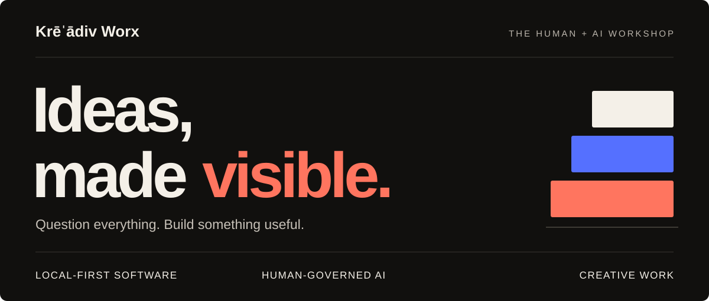
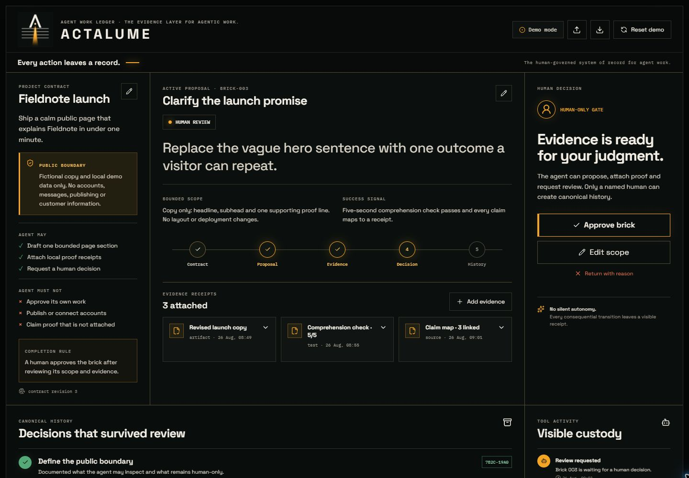
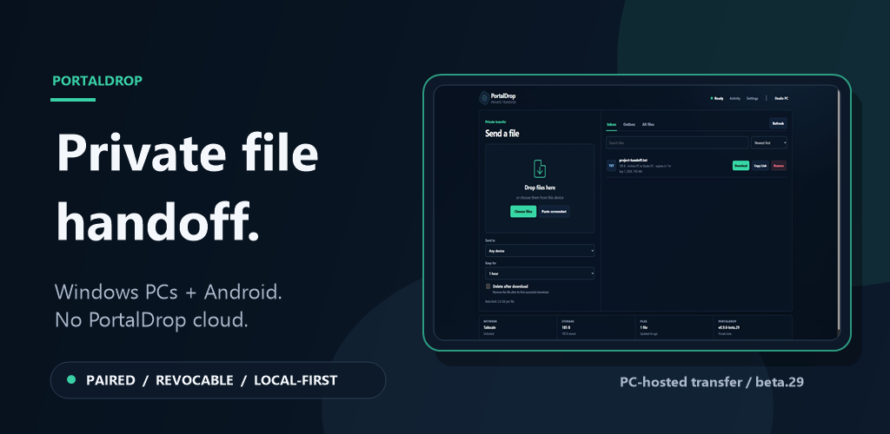
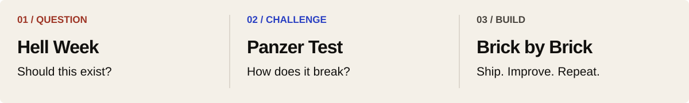

<a href="https://blackstackdev.github.io/kreadiv-worx/">
  <picture>
  <source media="(max-width: 600px)" srcset="assets/hero-mobile.svg" />
  
  </picture>
</a>

  <a href="https://blackstackdev.github.io/kreadiv-worx/"><strong>Explore the studio</strong></a> &nbsp; · &nbsp;
  <a href="https://github.com/blackstackdev?tab=repositories"><strong>Public projects</strong></a> &nbsp; · &nbsp;
  <a href="https://x.com/skillissue_md"><strong>Follow the build</strong></a>

## Hey, I'm Raiden.

The human behind **Krēˈādiv Worx**. I turn everyday frustrations, creative ideas and a lot of “what if?” into things people can actually use.

I lead product direction, design decisions and testing. **Codi, my AI collaborator working with Codex, helps turn that direction into software.** Human judgment stays in the loop—from the first question to the release decision.

Local-first tools. Agents with boundaries. A little creative chaos.

---

## Start here → Actalume

### Agents do the work. Humans keep the final say.

A human-governed record of agent work: what was requested, what changed, what evidence exists and who approved it. Agents can propose work and request review; they cannot approve their own work.

**Public demo · Open source · WebMCP**

[Explore the demo](https://blackstackdev.github.io/actalume/) · [Watch it working](https://youtu.be/W7TDj8BiLsw) · [Read the source](https://github.com/blackstackdev/actalume)

Native WebMCP execution was demonstrated in Chrome with “WebMCP for testing” enabled. That is testing-flag proof, not a claim of universal browser support.

## Useful software, taking shape

### PortalDrop — your files, your handoff.

Move files between trusted Windows PCs and Android devices through a Windows host you control. Same-Wi-Fi handoff works directly; Tailscale is an optional route for remote access.

**Private beta · Windows + Android** — [See the product and real transfer demo](https://blackstackdev.github.io/kreadiv-worx/portaldrop/). Public installation is not open yet.

### NestKeeper — find the copies. Keep the control.

A local-only Windows tool for reviewing exact duplicate files before deciding what to remove. **Release candidate; checkout is not live.** [Inspect the product and proof](https://blackstackdev.github.io/kreadiv-worx/nestkeeper/).

### PromptDeck — give good prompts a home.

A local-first prompt library for visual creators, with reusable finishing presets, editing and import/export. **Android internal testing; not a public Play Store release.**

---

## More from the public workshop

| Project | What it explores |
| :--- | :--- |
| [Bounded Memory Core](https://github.com/blackstackdev/bounded-memory-core) | Agent memory that needs an adult's approval before recall. A fictional-data Scouting prototype, not an official records system. |
| [Is The Road Open? — Western Cape](https://github.com/blackstackdev/is-the-road-open-wc) | A human-reviewed road-evidence agent grounded in public sources. Evidence and provenance, not a road-safety guarantee. |
| [AI Eyes](https://github.com/blackstackdev/ai-eyes) | Permission-first screen-and-audio co-presence controls. A capture/session prototype; no AI understanding or provider connection yet. |

## How we build: the Three Bricks

1. **Hell Week** — Who is this for? What problem does it solve? Should it exist?
2. **Panzer Test** — How does it break? Challenge the assumptions before getting attached.
3. **Brick by Brick** — Ship something useful. Learn. Improve. Repeat.

> Don't build monuments. Build foundations.

## The human + AI workshop

Across the public projects: **TypeScript · React · Python · WebMCP · CockroachDB · AWS · Google Cloud**. Tools serve the problem; they aren't the product.

I'm interested in local-first software, useful human–AI collaboration and creative work with something real behind it. If that sounds like your corner of the internet, [come say hey](https://x.com/skillissue_md).

  <strong>Krēˈādiv Worx</strong> 
  Ideas, made visible. One brick at a time.

